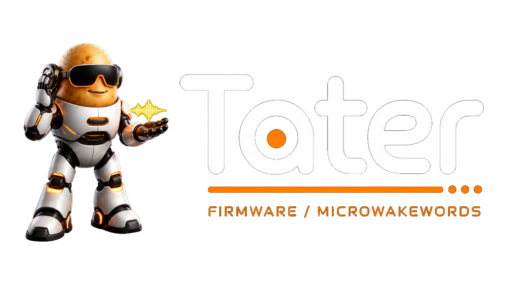

<div align="center">
  <a href="https://taterassistant.com">
    
  </a>
</div>

<p align="center">
  <a href="https://taterassistant.com">
    
  </a>
</p>

# Tater Wake Words

Ready-to-use wake words for Tater voice satellites, with packages for Tater,
the Home Assistant bridge, and ESPHome.

## Choose Your Setup

| Use with | What it does |
| --- | --- |
| [Tater Assistant](https://github.com/TaterTotterson/Tater) | Pair satellites with the main Tater app for voice conversations, tools, music, and room playback. |
| [Home Assistant bridge](https://github.com/TaterTotterson/Tater-Home-Assistant-Satellites) | Connect compatible satellites directly to Home Assistant. Use HA Assist or optional Mini-Tater without the main Tater app. |

## Satellite Firmware

Choose the firmware or runtime for your device. Each project lists supported
hardware and installation instructions.

| Your hardware | Firmware or runtime |
| --- | --- |
| Voice PE, Satellite1, ReSpeaker XVF3800 or ESP32-S3-BOX-3 | [Tater Native Firmware](https://github.com/TaterTotterson/Tater-Native-Firmware) |
| Supported, unlocked Amazon Echo, Dot, Show or Spot | [Tater Echo Firmware](https://github.com/TaterTotterson/Tater-Echo-Firmware) |
| Linux computer or Raspberry Pi with a microphone and speaker | [Tater Linux Satellite](https://github.com/TaterTotterson/Tater-Linux-Satellite) |
| ThirdReality Voice & Music Assistant (S420) | [Tater ThirdReality Voice Firmware](https://github.com/TaterTotterson/Tater-ThirdReality-Voice-Firmware) |

## Use A Wake Word

Choose a word from the catalog in Tater's wake-word settings or the bridge's
**Voice defaults**. You can also paste a V9 `.wake-bundle.json` URL directly.
[Browse the latest V9 packages](microWakeWordsV9).

For example, this package uses **Hey Tater**:

```text
https://raw.githubusercontent.com/TaterTotterson/Tater-Wake-Words/main/microWakeWordsV9/hey_tater.wake-bundle.json
```

The same bundle works with Tater and the bridge. Only the models supported by
each satellite are sent to it, including the wake-boundary model that helps
preserve speech immediately after the wake word.

**Using ESPHome?** Use the matching `.esphome.json` URL with its
`micro_wake_word` component.

## Request A Wake Word

Open a [wake-word request](https://github.com/TaterTotterson/Tater-Wake-Words/issues/new)
with a title in this format:

```text
mww: hey potato
```

Only issues whose title starts with `mww:` are handled by automation.

When the Apple trainer watcher completes successfully, it adds the canonical
bundle, ESPHome MWW JSON, MWW TFLite, OWW ONNX, NWW CNN ONNX, NWW GRU ONNX,
and wake-boundary TFLite to `microWakeWordsV9`. It then updates the catalog
manifest, comments with all artifact links, and closes the issue. Issue
processing is handled by the independent watcher on the training Mac.

## Package Details

New V9 packages contain:

- `.wake-bundle.json` schema-v4 Tater metadata for MWW, OWW, NWW-CNN, NWW-GRU, and wake-boundary models
- `.esphome.json` ESPHome-compatible microWakeWord metadata
- `.tflite` microWakeWord models
- `.oww.onnx` openWakeWord models
- `.nww.cnn.onnx` NanoWakeWord CNN models
- `.nww.gru.onnx` NanoWakeWord GRU models
- `.boundary.tflite` per-word wake-end boundary models shared by every Tater detector mode
- `wake_word_manifest.json` for bundle and engine catalog discovery

The same bundle supplies MWW, OWW, NWW-CNN, NWW-GRU, MWW+OWW, or MWW+NWW
according to the selected detector mode and satellite support.

The catalog manifest exposes verified views for **microWakeWord**,
**openWakeWord**, **NanoWakeWord** (CNN and GRU), **Dual Wake Word**,
**Wake Boundary**, and **Wake Word Bundle**. V9 entries are listed only after
the bundle and all five model files pass filename, size, and SHA-256 validation.

New issue-generated wake words are added to `microWakeWordsV9`. Versions 1–8
remain available in their original formats for existing installations; V8 keeps
the earlier schema-v3 bundle layout without a wake-boundary model. The V1–V3
folders come from the original Tater wake-word collection.

## License

Original code, metadata, and model artifacts produced and published by this
project are available under the [MIT License](LICENSE).

Historical model assets and third-party components remain subject to any
applicable source licenses and are not relicensed where the project does not
hold those rights. Wake-word phrases may contain third-party names or
trademarks; inclusion in this catalog does not grant rights to use them.

## Trademarks

The Tater name and logo are governed by the [Tater Trademark Policy](TRADEMARKS.md).
