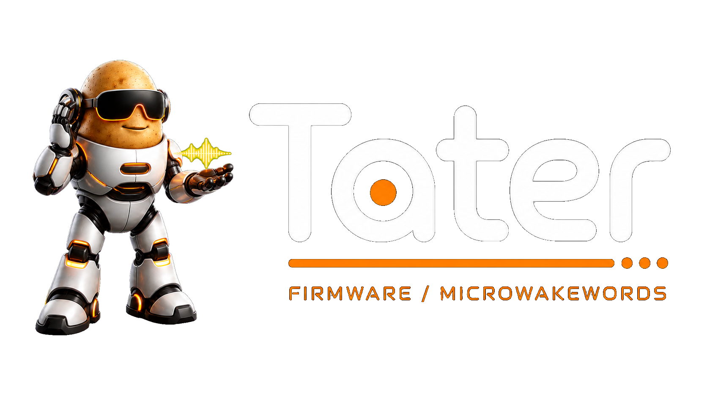

<div align="center">
  <a href="https://taterassistant.com">
    
  </a>
</div>

<p align="center">
  <a href="https://taterassistant.com">
    
  </a>
</p>

# Tater Wake Words

Tater wake-word catalog for Tater Native satellites.

This repo stores ready-to-use wake-word packages. New V8 packages contain:

- `.wake-bundle.json` canonical Tater metadata for MWW, OWW, NWW-CNN, and NWW-GRU
- `.esphome.json` ESPHome-compatible microWakeWord metadata
- `.tflite` microWakeWord models
- `.oww.onnx` openWakeWord models
- `.nww.cnn.onnx` NanoWakeWord CNN models
- `.nww.gru.onnx` NanoWakeWord GRU models
- `wake_word_manifest.json` for bundle and engine catalog discovery

The historical catalog folders are seeded from the original Tater wake-word collection:

- `microWakeWordsV1`
- `microWakeWordsV2`
- `microWakeWordsV3`

New issue-generated wake words are added to `microWakeWordsV8`. Versions 1–7
remain available for existing installations.

## Use A Wake Word

Use a V8 `.wake-bundle.json` URL in Tater. The same package supplies MWW, OWW,
NWW-CNN, NWW-GRU, MWW+OWW, or MWW+NWW according to the selected detector mode.
For ESPHome's `micro_wake_word`, use the matching `.esphome.json` URL.

Example:

```text
https://raw.githubusercontent.com/TaterTotterson/Tater-Wake-Words/main/microWakeWordsV8/hey_tater.wake-bundle.json
```

Tater downloads the bundle and only the model files needed by each satellite.

The catalog manifest exposes verified views for:

- **microWakeWord**
- **openWakeWord**
- **NanoWakeWord** with CNN and GRU architectures
- **Dual Wake Word**
- **Wake Word Bundle**

V8 entries are listed only after the bundle and all four model files pass
filename, size, and SHA-256 validation. Older catalog entries remain listed in
their original formats.

## Request A Wake Word

Open an issue with a title in this format:

```text
mww: hey potato
```

Only issues whose title starts with `mww:` are handled by automation.

When the Apple trainer watcher completes successfully, it adds the canonical
bundle, ESPHome MWW JSON, MWW TFLite, OWW ONNX, NWW CNN ONNX, and NWW GRU ONNX
to `microWakeWordsV8`. It then updates the catalog manifest, comments with all
artifact links, and closes the issue. Issue processing is handled by the
independent watcher on the training Mac.

## License

Original code, metadata, and model artifacts produced and published by this
project are available under the [MIT License](LICENSE).

Historical model assets and third-party components remain subject to any
applicable source licenses and are not relicensed where the project does not
hold those rights. Wake-word phrases may contain third-party names or
trademarks; inclusion in this catalog does not grant rights to use them.
